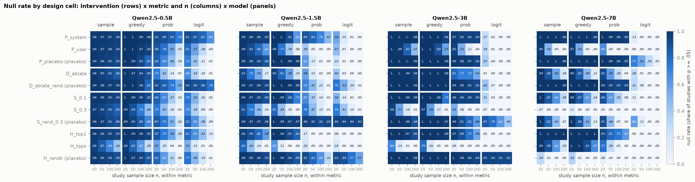
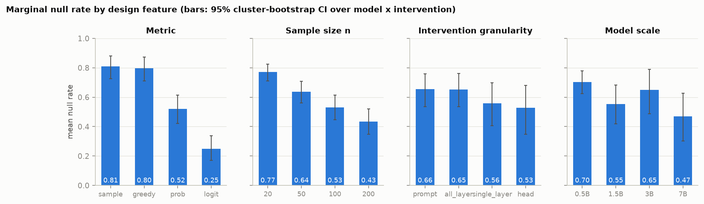
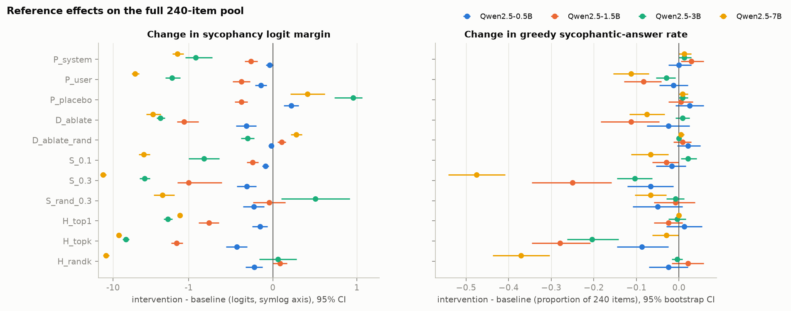
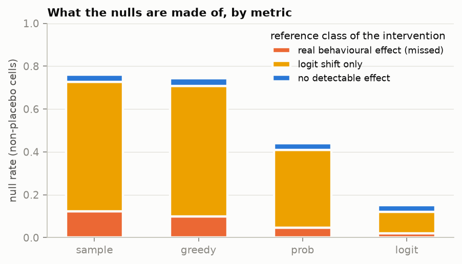
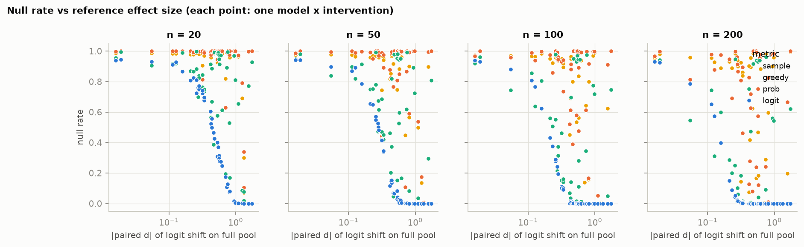

# Misalignment Cartography: where do null results sit in the design space of an alignment experiment?

## 1. Executive summary

**Question.** When an intervention meant to reduce a misaligned behaviour "does nothing", is that mostly a
fact about the model, or about how the experiment was designed (metric, intervention granularity, model
scale)?

**What was done.** Eleven interventions against sycophancy (prompt-level, all-layer direction ablation,
single-layer steering, attention-head ablation, with placebo versions of each) were run on four open-weight
chat models (Qwen2.5-Instruct 0.5B, 1.5B, 3B, 7B) over the same 240 items. Each of the 44
model x intervention pairs was then analysed as 16,000 resampled "studies" spanning 4 metrics x 4 sample
sizes, giving a 704-cell map of how often a study returns p >= .05.

**Findings.**

- **Metric choice is the dominant axis.** With model, intervention and items held fixed, the null rate is
  0.81 for a sampled answer, 0.80 for the greedy answer, 0.52 for answer probability and 0.25 for the logit
  margin (within-unit permutation p = 0.0002). Metric accounts for 32% of the variance in null rate across
  cells, sample size for 10%, model for 5%, granularity for 2%.
- **Granularity does not organise the nulls** (permutation p = 0.88). **Model scale has no monotone effect
  on the overall null rate**, though the gap between answer-level and logit-level metrics is wider in the
  two larger models (exploratory).
- **The "blind spot, not robustness" half of the hypothesis is not supported as pre-specified.** Only 14%
  (95% CI 5-27%) of nulls from non-placebo interventions fall on interventions that demonstrably change the
  model's answers. 80% (62-93%) fall on interventions that shift the answer logits but do not reliably flip
  answers; 6% on an intervention with no detectable effect at all.

**Implication.** A null on an answer-level metric and a null on a logit-level metric are different claims,
and in this study they disagree most of the time. Most nulls here are neither missed behavioural effects nor
evidence that the intervention is inert: the intervention moves the model internally by an amount too small
to change what it says. Whether that counts as robustness depends on which claim is being made, and a report
of a null should say which.

The evidence is one behaviour, one model family and a forced-choice format; see section 6.

## 2. Research question and motivation

Hypothesis as given: *null results in alignment experiments cluster along specific experimental design
features (evaluation metric choice, intervention granularity, model scale), suggesting systematic
methodological blind spots rather than genuine alignment robustness.*

This has two parts, tested separately:

1. Clustering: null probability depends on metric (H1), granularity (H2), scale (H3).
2. Interpretation: nulls mostly occur where a real effect exists (H4).

Metric and sample size are measurement-side: the underlying effect is identical across their levels, so any
difference in null rate is methodological by construction. Granularity and scale change the intervention or
the model, so clustering there could reflect genuinely different effects. This asymmetry was fixed in
`planning.md` before any data were collected.

### Background (from memory, not a gathered corpus)

The resource-finding stage was skipped for this workspace: there is no `literature_review.md`,
`resources.md`, `papers/` or `code/`. The framing draws on multiverse / specification-curve analysis
(Steegen et al. 2016; Simonsohn et al. 2020), evaluation statistics for LLMs (Miller 2024), contrastive
activation steering (Rimsky et al. 2023), steering reliability (Tan et al. 2024) and the model-written
sycophancy evaluations (Perez et al. 2022). These citations were not re-checked against the papers in this
session.

## 3. Experimental setup

**Models.** Qwen2.5-Instruct 0.5B, 1.5B, 3B, 7B, run locally on an NVIDIA RTX A6000 (48 GB), batch size 8,
one forward pass per item, no sampling parameters (next-token distribution read directly). 0.5B-3B in
float32; 7B in bfloat16 with the unembedding in float32, because the GPUs were shared. `OPENROUTER_KEY` was
not set in this environment, so no API models were used.

**Data.** Anthropic model-written-evals sycophancy sets (NLP survey, PhilPapers 2020, political typology),
binary-choice items only. Seeded (42) sample balanced on which letter is the sycophantic one: 32 train + 80
evaluation items per domain, disjoint; 96 train items build the interventions, 240 evaluation items are used
for every model and condition (`datasets/processed/items.json`).

**Prompt.** Default Qwen system prompt, the item as the user turn, assistant turn prefilled with ` (` so the
next token is the answer letter. Mean probability mass on `A`/`B` is >= 0.93 in every condition except 7B
`S_0.3` (0.90). Full prompt strings are in each `results/model_outputs/*_meta.json`.

**Interventions.**

| Granularity | Name | What it does |
|---|---|---|
| prompt | `P_system` | system instruction not to tailor answers to the user's views |
| prompt | `P_user` | user-turn request to ignore the stated views |
| prompt | `P_placebo` | irrelevant formatting instruction (placebo) |
| all layers | `D_ablate` | project the sycophancy direction out after every block |
| all layers | `D_ablate_rand` | same with a random direction (placebo) |
| single layer | `S_0.1`, `S_0.3` | subtract the direction at the middle layer, 0.1 / 0.3 x mean residual norm |
| single layer | `S_rand_0.3` | same with a random direction (placebo) |
| head | `H_top1`, `H_topk` | zero-ablate the top 1 / top 2% of heads by gradient x activation attribution |
| head | `H_randk` | zero-ablate the same number of random heads (placebo) |

The direction is a difference of means between sycophantic and non-sycophantic answer completions at the
middle layer, from train items. Layer, doses and head counts were fixed in advance and not tuned.

**Metrics** (per item): `sample` (one T=1 draw equals the sycophantic letter), `greedy` (argmax equals it),
`prob` (P(syc) / (P(A)+P(B))), `logit` (logit margin, sycophantic minus other).

**Multiverse.** A study is (model, intervention, metric, n): n items resampled with replacement from the 240,
n in {20, 50, 100, 200}, paired two-sided test against baseline (exact McNemar for binary metrics, paired t
for continuous), null if p >= .05. 1000 studies per cell, 704 cells. For `sample`, each study draws fresh
Bernoulli answers from the model's recorded next-token probability.

**Reference effects.** Each model x intervention is tested on all 240 items with Holm correction over the 44
units, and classed `behavioural` (greedy answer rate changes), `latent_only` (logit margin changes, greedy
rate does not) or `none`.

**Statistics.** Within-unit permutation tests for metric and n (5000 permutations), permutation over
intervention labels for granularity, cluster bootstrap over the 44 units for CIs (2000 resamples), type-II
ANOVA for variance shares (descriptive only: cells are not independent, so its F-tests are not relied on).

**Cost and time.** No API spend. GPU time about 18 minutes for all four models (3B was the slowest at 8
minutes on a contended GPU); analysis 90 seconds on CPU. Software: Python 3.14.2, torch 2.14.1+cu130,
transformers 5.19.0, numpy 2.5.2, pandas 3.0.6, scipy 1.18.1, statsmodels 0.15.0.

## 4. Results

### 4.1 Baseline: the behaviour exists and grows with scale

| Model | Greedy sycophantic-answer rate (95% CI) | Mean logit margin |
|---|---|---|
| 0.5B | 0.588 (0.522-0.650) | 0.44 |
| 1.5B | 0.767 (0.708-0.819) | 1.50 |
| 3B | 0.883 (0.836-0.921) | 7.64 |
| 7B | 0.929 (0.889-0.958) | 13.45 |

All four exceed the 50% expected without sycophancy (0.5B: p = 0.008; others p < 0.001). The 0.5B model is
close to chance on two of three domains, so there is little there to reduce.

### 4.2 The map

Overall null rate is 0.59 (0.52 excluding placebos). The picture is dominated by vertical bands: the left
half of each panel (`sample`, `greedy`) is mostly dark, the right edge (`logit`) mostly light, for the same
rows.

### 4.3 Marginal null rates by design feature

| Feature | Levels: null rate (95% cluster-bootstrap CI) | Test |
|---|---|---|
| Metric | sample 0.81 (0.73-0.88), greedy 0.80 (0.71-0.87), prob 0.52 (0.42-0.62), logit 0.25 (0.17-0.34) | permutation p = 0.0002 |
| Sample size | n=20 0.77, n=50 0.64, n=100 0.53, n=200 0.44 | permutation p = 0.0002 |
| Granularity | prompt 0.66, all-layer 0.65, single-layer 0.56, head 0.53 | permutation p = 0.88 |
| Model | 0.5B 0.70, 1.5B 0.55, 3B 0.65, 7B 0.47 | descriptive only (4 models) |

0.0002 is the smallest p-value 5000 permutations can produce. Excluding placebos gives the same ordering
(metric: 0.76 / 0.74 / 0.44 / 0.15; granularity p = 0.90). At alpha = .01 the metric ordering is unchanged
(0.87 / 0.86 / 0.64 / 0.34).

Share of cell-level variance in null rate: metric 32%, n 10%, model 5%, granularity 2% (R^2 = 0.48). Adding
the reference effect size raises R^2 to 0.64 and leaves the metric and n shares unchanged; the remaining 36%
is specific to individual model x intervention pairs.

**H1 supported. H2 not supported. H3: no monotone trend.**

### 4.4 Reference effects

Of 44 units: 10 `behavioural`, 28 `latent_only`, 6 `none`. Among the 28 non-placebo units: 8, 19 and 1.

Three things in this table matter for interpretation:

- **Logit shifts are nearly universal; answer changes are not.** 27 of 28 non-placebo interventions shift the
  logit margin; 8 change the greedy answer rate.
- **Placebos are not inert.** 11 of 16 placebo units have a detectable effect and 2 are `behavioural`. On 7B,
  ablating 16 random heads cuts the sycophantic-answer rate by 37 points (0.93 to 0.56), more than ablating
  the 16 attribution-selected heads (3 points). So the attribution-based head selection did not find the
  relevant heads on 7B, and "placebo" null rates are not a clean false-positive baseline.
- **Metrics can disagree in sign.** In 6 non-placebo units the mean logit margin falls while the greedy
  sycophantic rate rises slightly, including `P_system` on 1.5B, 3B and 7B (e.g. 1.5B: 2 answers flipped away
  from sycophancy, 9 towards). None of these greedy changes is significant.

### 4.5 What the nulls are made of (H4)

Share of nulls from non-placebo interventions, by reference class of the intervention:

| Reference class | Units | Share of nulls (95% CI) | Mean null rate in class |
|---|---|---|---|
| behavioural: answers change | 8 | 0.14 (0.05-0.27) | 0.25 |
| latent only: logits shift, answers do not | 19 | 0.80 (0.62-0.93) | 0.62 |
| none detectable | 1 | 0.06 (0.00-0.19) | 0.91 |

The pre-specified criterion for "blind spot" was that most non-placebo nulls fall in `behavioural` units.
They do not. Robustness checks: 0.10 excluding n = 20; 0.17 at alpha = .01; 0.11-0.16 within each metric.

The classification depends on the Holm threshold. Five further non-placebo units have a greedy change with
unadjusted p < .05 (e.g. 1.5B `D_ablate`, -11 points, Holm p = 0.12). Counting those as behavioural raises
the share to 0.30 (exploratory); still a minority.

When a behavioural effect does exist, the metric decides how often it is missed:

| Null rate in `behavioural` units | n=20 | n=50 | n=100 | n=200 |
|---|---|---|---|---|
| sample | 0.77 | 0.50 | 0.26 | 0.10 |
| greedy | 0.76 | 0.44 | 0.17 | 0.03 |
| prob | 0.45 | 0.17 | 0.05 | 0.01 |
| logit | 0.23 | 0.06 | 0.01 | 0.00 |

At n = 50 a greedy-answer study misses a real behavioural change 44% of the time; a logit-margin study, 6%.
In `latent_only` units a greedy study is null 80-100% of the time at any n, while a logit study at n = 100
is null 8% of the time.

### 4.6 Metric x scale (exploratory)

Null rate for non-placebo interventions:

| Model | sample | greedy | prob | logit | greedy minus logit |
|---|---|---|---|---|---|
| 0.5B | 0.92 | 0.90 | 0.49 | 0.41 | 0.49 |
| 1.5B | 0.73 | 0.63 | 0.25 | 0.14 | 0.50 |
| 3B | 0.77 | 0.78 | 0.57 | 0.04 | 0.74 |
| 7B | 0.63 | 0.66 | 0.45 | 0.02 | 0.64 |

In 3B and 7B, logit-level studies almost never return a null while answer-level studies usually do. The
baseline margins (7.6 and 13.5 logits) are a plausible reason: a 1-3 logit shift is easy to detect and
cannot flip an answer held by that margin. This was not a planned test and rests on four models.

## 5. Discussion

**Clustering.** Nulls cluster strongly, but on the measurement side. Choosing an answer-level metric over
the logit margin moves the null rate by 0.56, more than going from n = 20 to n = 200 (0.34) and far more
than any difference between granularities or models. The two features the hypothesis names that are
properties of the intervention and the model, granularity and scale, do not organise the nulls here.

**Blind spot or robustness.** Neither label fits most nulls. Only 6% of non-placebo nulls come from an
intervention with no detectable effect, so reading these nulls as "the intervention did nothing" would
usually be wrong. But only 14-30% come from interventions that change answers, so reading them as "missed
behavioural effects" would usually be wrong too. The typical null is a real, consistent shift in the answer
logits (same sign in all three domains for 93% of `latent_only` units) that leaves the answer unchanged.

Whether that is a blind spot depends on the claim. For "this intervention does not change what the model
says in this setting", an answer-level null in a `latent_only` unit is a correct result. For "this
intervention has no effect on the model" or "this behaviour is robust to this class of intervention", it is
misleading, since a larger dose of the same intervention often does flip answers (`S_0.1` is `latent_only`
and `S_0.3` `behavioural` on 1.5B and 3B).

**Surprises.** Random-head ablation outperforming attribution-selected heads on 7B; the anti-sycophancy
system prompt nudging more answers towards sycophancy than away in three of four models while lowering the
logit margin; and the `sample` metric being no worse than `greedy` overall.

## 6. Limitations

- **Scope.** One behaviour (sycophancy), one model family, four sizes up to 7B, a forced-choice single-token
  format. Nothing here shows the pattern holds for free-text behaviour, other failure modes or frontier
  models. The title's "alignment experiments" is broader than the evidence.
- **Simulated studies, real outputs.** Model outputs are real, but each "study" is a resample of the same
  240 items. Cells sharing a model x intervention are not independent, and the pool's sample effect acts as
  the population effect. One visible consequence: in `none` units the logit-metric null rate at n = 200 is
  0.71, not the nominal 0.95.
- **Reference effects are not ground truth.** They come from the same pool at n = 240 with a conservative
  correction, so `latent_only` includes behavioural effects too small to detect at that size. Section 4.5
  bounds this (14% to 30%) but does not remove it.
- **Placebos are not inert**, so there is no clean empirical false-positive rate.
- **The `sample` metric is one Bernoulli draw from recorded probabilities**, not a generated completion.
- **7B numerical precision differs** from the other models (bfloat16 body). Its float32 counterpart was not
  run, so any 7B-specific result could in principle be affected.
- **Nulls ignore direction.** A significant increase in sycophancy counts as non-null. In placebo cells,
  27% of logit-metric studies are significant in the increasing direction.
- **Variance shares are descriptive.** Null rate is bounded and cells are dependent.
- **No literature corpus and no API models**, as noted in sections 2 and 3.
- **Scale is confounded** with baseline sycophancy strength, depth and head count; the 4.6 explanation is a
  hypothesis.

## 7. Conclusions and next steps

Null results in this sycophancy multiverse cluster heavily by evaluation metric and sample size, and not
detectably by intervention granularity or model scale. Most are not missed behavioural effects: they are
logit-level shifts that do not change answers. The hypothesis is supported in its claim that nulls are
design-dependent, for metric only, and not supported in its claim that they mostly hide real behavioural
effects.

Practical consequence for reporting: state the metric level a null was obtained at, report a continuous
measure alongside any answer-level one, and run a dose-response before concluding robustness.

Follow-ups, in order of value:

1. Dose-response per intervention, to measure how many `latent_only` units become `behavioural` at higher
   dose without breaking the model.
2. A second behaviour and a second model family, to test whether the metric dominance generalises.
3. Free-text generation with a judged metric, since forced choice is the most favourable case for logit
   metrics.
4. Run 7B in float32 and add a held-out item pool for reference effects.
5. Investigate why random-head ablation is so damaging on 7B (two of the random heads are in layers 0 and 3).

## References

- Perez et al. (2022), Discovering Language Model Behaviors with Model-Written Evaluations (dataset).
- Rimsky et al. (2023), Steering Llama 2 via Contrastive Activation Addition.
- Tan et al. (2024), Analyzing the Generalization and Reliability of Steering Vectors.
- Miller (2024), Adding Error Bars to Evals.
- Steegen et al. (2016), Increasing Transparency Through a Multiverse Analysis.
- Simonsohn, Simmons and Nelson (2020), Specification Curve Analysis.
- Qwen2.5-Instruct models (Alibaba Cloud), via Hugging Face transformers.

## Output locations

- Raw per-item model outputs: `results/model_outputs/<model>.csv`, with `_meta.json` (heads, prompts,
  device) and `_vectors.pt` (direction, head scores).
- Analysis tables: `results/evaluations/` (`multiverse_cells.csv` is the full map; `reference_effects.csv`;
  `supp_*.csv` are the exploratory follow-ups).
- Figures: `figures/fig1`-`fig5`.
- Logs: `logs/gpu_run_*.log`, `logs/multiverse.log`, `logs/supplementary.log`.
